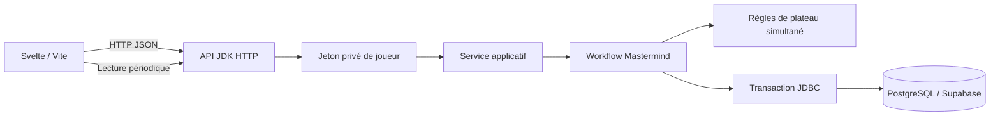

# Architecture actuelle à Mastermind Arena

Ce document décrit le code actuel, et non l'ancienne cible de plateforme générique. Cette cible est archivée dans [archive/architecture-cible-initiale.md](archive/architecture-cible-initiale.md).

## Composants

- **Front** : Svelte 5, Vite, JavaScript ; une application monopage. Ce n'est pas SvelteKit.
- **API** : serveur HTTP du JDK sous Java 21, JSON avec Jackson. Ce n'est pas Spring Boot.
- **Application** : adaptation des commandes HTTP et traduction des rejets.
- **Métier** : `SubmitActionOrchestrator`, `MastermindBoardRules`, `MatchRuntimeState` et journal d'actions avec numéro de tour explicite.
- **Persistance** : interfaces de stockage, implémentation JDBC PostgreSQL. Le format historique du codec reste compatible en lecture.
- **Schéma** : scripts SQL exécutés par `JdbcSchemaMigrator`. Flyway n'est pas utilisé.
- **Synchronisation** : requêtes HTTP après une action et polling toutes les six secondes ; pas de transport WebSocket connecté au front. Les anciennes abstractions WebSocket ne sont pas une fonctionnalité livrée.

## Cohérence et sécurité

Chaque action porte un joueur, une version attendue et une clé d'idempotence. La transaction PostgreSQL prend un verrou par match, puis sauvegarde État, Événement et idempotence sur une même connexion. Une panne de cette transaction doit annuler les écritures. Les tests métier mémoire ne prouvent pas à eux seuls le fonctionnement de cette transaction sur PostgreSQL : voir le plan de validation.

Les jetons de joueur sont aléatoires ; seuls leurs hachages sont conservés dans la table `rooms`. Le code partagé d'accès utilise PBKDF2 avec un sel. La vue HTTP masque les secrets et les propositions/indices en attente de publication. L'absence de room ne donne plus accès à un ancien match local.

La clé `VITE_API_KEY` est distribuée au navigateur et ne constitue pas un secret ni une identité de joueur. L'autorisation des parties repose sur le jeton privé. Le code de reprise contient l'identifiant de partie, la place et ce jeton ; il est envoyé en corps POST, jamais en URL.

## Déploiement

Deux projets Vercel distincts sont reliés à `main`. Le front appelle l'URL du backend. La base PostgreSQL est hébergée sur Supabase. Les origines CORS du backend doivent correspondre à l'origine du front. Une pause de Supabase rend les opérations de partie indisponibles ; ce cas doit Être vérifié avant la démonstration du 23 novembre 2026.

Les fichiers Railway et les anciennes implémentations fichier/préférences restent des traces de l'évolution du dépôt ; ils ne décrivent pas le déploiement actuel. Le produit livré est un jeu indépendant.
