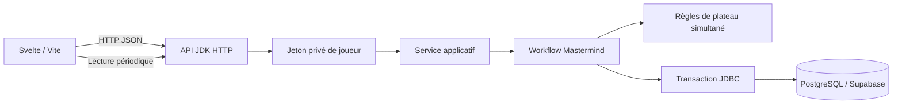

# Architecture actuelle à Mastermind Arena

Ce document décrit le code actuel, et non l'ancienne cible de plateforme générique. Cette cible est archivée dans [archive/architecture-cible-initiale.md](archive/architecture-cible-initiale.md).

## Composants

- **Front** : Svelte 5, Vite, JavaScript ; une application monopage. Ce n'est pas SvelteKit.
- **API** : serveur HTTP du JDK sous Java 21, JSON avec Jackson. Ce n'est pas Spring Boot.
- **Application** : adaptation des commandes HTTP et traduction des rejets.
- **Métier** : `SubmitActionOrchestrator`, `MastermindBoardRules`, `MatchRuntimeState` et journal d'actions avec numéro de tour explicite.
- **Persistance** : interfaces de stockage, JDBC PostgreSQL avec documents JSON `formatVersion:1` (`BoardPersistenceCodec`). Les formats historiques ne sont pas importés dans la base propre autorisée le 14 octobre.
- **Schéma** : migrations SQL enregistrées et appliquées une fois par `JdbcSchemaMigrator`. Flyway n'est pas utilisé. Protection RLS et révocation des droits API ; voir [DATABASE_REBUILD](DATABASE_REBUILD.md).
- **Synchronisation** : requêtes HTTP après une action et polling six secondes après la fin de la lecture précédente ; pas de transport WebSocket connecté au front. Les anciennes abstractions WebSocket ne sont pas une fonctionnalité livrée.

## Découpage du front

Les clients d'API partagent `httpClientUtils.requestJson` : timeout de quinze secondes incluant le transfert du corps, annulation par signal et lecture JSON. Les contrats de réponse et de rejet restent propres aux endpoints ; les métadonnées de conflit de soumission ne sont pas réduites à une erreur HTTP générique. La vérification de configuration des deux clients du jeu est commune. Ce déplacement conserve les fallbacks existants pour les corps vides ou illisibles ; leur harmonisation reste ouverte.

`App.svelte` coordonne les écrans. `state/session.js` isole le stockage privé ; `state/gameConnection.js` protège les lectures et soumissions par identité et génération. `state/polling.js` gère un seul timer, arrêté à la destruction, sans empiler les actualisations lentes.

`state/roomConnection.js` coordonne liste, attente, création, entrée et reprise privée. Les appels en cours sont partagés par catégorie ; une seule admission est autorisée à la fois. Chaque résultat est lié à l'écran, la place et une génération. Navigation, changement de partie et destruction annulent les lectures devenues inutiles et empêchent leurs retours de modifier une autre session. `roomClient` transmet le signal jusqu'au transport. App conserve l'application d'une admission : identité, sauvegarde privée et choix de l'écran.

L'annulation navigateur ne retire pas une admission déjà acceptée par le serveur. Les créations et entrées ne sont pas rejouées automatiquement après une réponse perdue ; la reprise d'une admission dont le jeton n'a jamais été reçu reste un cas à traiter séparément.

`state/boardDraft.js` conserve quatre positions explicites, même remplies hors ordre. `state/gameView.js` dérive les autorisations d'affichage, historiques et libellés depuis l'état serveur ; il ne calcule ni indices ni victoire. `PartieScreen` reçoit cette vue et émet les intentions ; ses compteurs d'indices et choix de panneau restent locaux. `utils/presentation.js` partage le formatage avec l'historique. Ces modules ne dépendent pas du DOM.

`utils/diagnostics.js` copie et masque les champs privés connus avant conservation des instantanés, puis avant formatage dans DebugDrawer. Le masquage porte sur la valeur entière, même structurée ou numérique. App efface les instantanés au changement de place et à l'oubli local. Le panneau n'offre pas de démasquage ; les valeurs originales ne sont pas retenues dans ces instantanés. Cette protection par nom de champ concerne les objets JSON des échanges actuels, pas un outil générique de détection de secrets dans tout texte arbitraire.

`state/phaseFocus.js` gère le défilement vers la phase active après rendu ; son adaptateur navigateur lit le DOM. Le contrôleur vérifie écran, onglet, match, acteur, jeton, manche et phase après l'attente de rendu. Navigation et destruction invalident le travail en attente. Il conserve l'espacement sous la barre fixe et ne répète pas le défilement à chaque polling. Le mouvement réduit utilise un déplacement immédiat. Malgré son nom, il ne déplace pas le focus clavier.

### Styles et thèmes

`app.css` contient les variables clair/sombre, les couleurs partagées du jeu, les règles de base et l'accessibilité commune (focus, texte masqué et mouvement réduit). Les trois classes historiques encore référencées par `symbolVisuals.js` restent présentes ; les anciennes couches de plateau et d'éditeur d'identité sans consommateur ont été retirées.

Chaque composant possède ses styles Svelte : barre supérieure, navigation, lobby, accueil, reprise, diagnostic et toast. App possède uniquement ses styles de mise en page, statut de partie et attente. Le mode compact du plateau est une classe de la racine et une propriété explicite de TopBar/BottomNav ; il ne dépend plus de sélecteurs globaux `:has()` qui modifiaient les composants enfants. Les breakpoints existants sont conservés.

## Cohérence et sécurité

`RequestBodyContract` valide les types JSON des quatre corps POST avant conversion vers les records HTTP. Le contrôle évite les conversions implicites en texte et les versions absentes/décimales ; il laisse au métier les règles d'action, de phase et d'auteur. La lecture du document HTTP externe et celle des JSON encodés dans les chaînes métier refusent doublons de clés et contenu après le document. Les codes d'erreur métier sont conservés. Le lecteur des paramètres GET refuse les noms répétés après décodage URL, avant autorisation de la place.

Le point d'entrée `LocalSubmitActionHttpServer` assemble les dépendances JDBC, initialise la base et enregistre les routes. Les classes package-local `GameHttpHandlers` (soumission, état et santé) et `RoomHttpHandlers` (liste, création, entrée et reprise) adaptent HTTP aux services existants. `HttpExchangeSupport` partage encodage JSON, lecture de corps bornée à 64 Kio, CORS, comparaison de clé et identifiant de requête. `HttpObservability` regroupe journaux structurés et compteurs en mémoire.

Chaque handler ferme l'échange dans un `finally`, après l'écriture éventuelle d'une erreur. CORS et clé d'API restent distincts de l'autorisation de place ; lectures privées et soumissions vérifient le jeton correspondant avant d'appeler l'endpoint. Les corps POST doivent être des objets JSON. Les erreurs de saisie et exceptions internes ont une réponse JSON distincte (400/INVALID_REQUEST et 500/SERVER_ERROR ou ROOM_SERVER_ERROR), sans message SQL publié. Les compteurs ne sont pas encore uniformes entre toutes les routes.

Chaque action porte un joueur, une version attendue et une clé d'idempotence. La transaction PostgreSQL prend un verrou par match, puis sauvegarde État, Événement et idempotence sur une même connexion. Une panne de cette transaction doit annuler les écritures. Les tests métier mémoire ne prouvent pas à eux seuls le fonctionnement de cette transaction sur PostgreSQL : voir le plan de validation.

Les jetons de joueur sont aléatoires ; seuls leurs hachages sont conservés dans la table `rooms`. Le code partagé d'accès utilise PBKDF2 avec un sel. La vue HTTP masque les secrets et les propositions/indices en attente de publication. L'absence de room ne donne plus accès à un ancien match local.

La clé `VITE_API_KEY` est distribuée au navigateur et ne constitue pas un secret ni une identité de joueur. L'autorisation des parties repose sur le jeton privé. Le code de reprise contient l'identifiant de partie, la place et ce jeton ; il est envoyé en corps POST, jamais en URL.

## Déploiement

Deux projets Vercel distincts sont reliés à `main`. Le front appelle l'URL du backend. La base PostgreSQL est hébergée sur Supabase. Les origines CORS du backend doivent correspondre à l'origine du front. Une pause de Supabase rend les opérations de partie indisponibles ; ce cas doit Être vérifié avant la démonstration du 23 novembre 2026.

Les fichiers Railway et les anciennes implémentations fichier/préférences restent des traces de l'évolution du dépôt ; ils ne décrivent pas le déploiement actuel. Le produit livré est un jeu indépendant.
