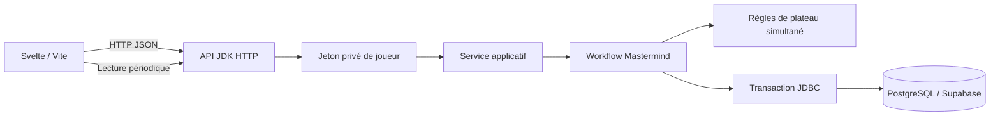

# Architecture actuelle à Mastermind Arena

Ce document décrit le code actuel, et non l'ancienne cible de plateforme générique. Cette cible est archivée dans [archive/architecture-cible-initiale.md](archive/architecture-cible-initiale.md).

## Composants

Complément UX du 27 octobre : roomConnection fournit des erreurs par source (liste, admission, statut, reprise) et des métadonnées d'admission pour les libellés. submissionFocus possède le suivi DOM du déclencheur et n'est lancé que par une intention utilisateur, jamais par le polling ; il vérifie vue/identité et déplacement du focus avant tout transfert après rendu. App coordonne la confirmation de correction ; PartieScreen conserve le brouillon local tant que la cible est modifiable et ferme après confirmation. ToastMessage présente la dernière erreur dans le flux avec fermeture manuelle ; App garde les succès à 2,4 secondes et la priorité d'une erreur non fermée. Ces changements ne modifient aucun contrat HTTP.

Compléments UI du 25 octobre : `PrivateRecoveryPanel` possède le dialogue natif de reprise (code masqué, visibilité explicite, copie et oubli local), sans client HTTP ni stockage supplémentaire. Le résultat asynchrone de copie est ignoré si le code a changé ou si le dialogue n'est plus ouvert. App conserve les fermetures de notifications de jeu en mémoire pour la partie/manche courante, y compris lors de l'aller-retour vers l'historique ; un rechargement peut les réafficher. Aucun délai de disparition automatique.

`gameView.researchSummaries` projette uniquement les drapeaux de découverte fournis par le serveur et retrouve l'essai publié correspondant dans les indices effectifs ; il ne compare pas de secret et n'attribue aucun point. Une recherche non confirmée comme trouvée n'affiche aucune combinaison de résultat. L'historique présente les versions dans l'ordre chronologique, utilise `originalFeedback` pour l'action initiale puis les valeurs propres à chaque correction. `referencedTurnNumber` rattache les notifications au tour de leurs indices cibles, distinct du tour au moment de leur demande.

Correction et abandon : PartieScreen garde les compteurs locaux et les mêmes événements/version cible. La correction du dernier tour terminé utilise un panneau dédié, laisse les lignes du plateau montées et conserve le déclencheur pour rendre le focus à l'annulation. Le dialogue d'abandon utilise `showModal()` et `close()` natifs ; l'événement close retire ensuite le dialogue, afin de laisser le navigateur restaurer le focus. Il n'ajoute ni dépendance ni nouvelle route. Le résultat conserve sa projection serveur et la revanche ses consentements existants.

Présentation du duel au 24 octobre : PartieScreen partage les styles `code-editor` entre secret et essai, sans déplacer les brouillons ni les intentions. L'attente d'essai affiche uniquement l'essai propre reçu du snapshot autorisé ; l'attente d'indices utilise les indicateurs existants. La comparaison et le reçu d'essai ajustent la taille des jetons de CodePegs par variables CSS ; les valeurs par défaut restent celles des petits jetons historiques. Les compteurs d'indices conservent leur logique manuelle et leur plafond commun ; les nombres sur les lignes d'essais comptent seulement les indices déclarés reçus.

- **Front** : Svelte 5, Vite, JavaScript ; une application de jeu monopage et deux documents d’information autonomes. Ce n'est pas SvelteKit.
- **API** : serveur HTTP du JDK sous Java 21, JSON avec Jackson. Ce n'est pas Spring Boot.
- **Application** : adaptation des commandes HTTP et traduction des rejets.
- **Métier** : `SubmitActionOrchestrator`, `MastermindBoardRules`, `MatchRuntimeState` et journal d'actions avec numéro de tour explicite.
- **Persistance** : interfaces de stockage, JDBC PostgreSQL avec états JSON `formatVersion:1` et reçus `formatVersion:2` (`BoardPersistenceCodec`). Les formats historiques ne sont pas importés dans la base propre autorisée le 14 octobre.
- **Schéma** : migrations SQL enregistrées et appliquées une fois par `JdbcSchemaMigrator`. Flyway n'est pas utilisé. Protection RLS et révocation des droits API ; voir [DATABASE_REBUILD](DATABASE_REBUILD.md).
- **Synchronisation** : requêtes HTTP après une action et polling six secondes après la fin de la lecture précédente ; pas de transport WebSocket connecté au front. Les anciennes abstractions WebSocket ne sont pas une fonctionnalité livrée.

## Découpage du front

`utils/apiErrorText.js` traduit uniquement les codes d'erreur connus en messages utilisateur pour le lobby, la synchronisation et les soumissions. Les erreurs originales restent dans les coordinateurs pour les décisions de retry ; leur contenu arbitraire n'est pas affiché par App. Une annulation n'affiche pas d'alerte ; un résultat de soumission inconnu n'est pas présenté comme un échec d'écriture certain.

Les clients d'API partagent `httpClientUtils.requestJson` : timeout de quinze secondes incluant le transfert du corps, annulation par signal et lecture JSON. Les contrats de réponse et de rejet restent propres aux endpoints ; les métadonnées de conflit de soumission ne sont pas réduites à une erreur HTTP générique. La vérification de configuration des deux clients du jeu est commune. Un succès vide ou illisible produit `HTTP:INVALID_RESPONSE_BODY` avec une métadonnée locale `responseBodyState`, sans corps brut retenu dans l'erreur : message précis et replay exact conservés. Les réponses HTTP non réussies gardent leurs validateurs et fallbacks existants.

`App.svelte` coordonne les écrans. `state/session.js` isole le stockage privé ; `state/gameConnection.js` protège les lectures et soumissions par identité et génération. `state/polling.js` gère un seul timer, arrêté à la destruction, sans empiler les actualisations lentes.

`WaitingScreen.svelte` présente l'attente à partir du nom, du créateur, de l'accès ouvert/protégé et de l'erreur fournis par App. Il émet les intentions actualiser, retour au salon et oubli local ; aucune lecture HTTP, gestion de session ou boucle de polling n'est déplacée dans ce composant. Les vues d'entrée et le duel partagent désormais les tokens sombres de la refonte, limités à leur coque ; la palette claire existante est conservée. Les styles des contrôles restent locaux aux composants.

Le chargement du statut d'attente est transmis par `roomConnection.onStatusBusy`, distinct du chargement d'admission. Les lectures partagées ne créent pas plusieurs indicateurs ; invalidation et fin de la requête propriétaire le réinitialisent. Une ancienne fin de requête ne peut pas effacer celui d'une lecture plus récente. WaitingScreen annonce « Actualisation… », conserve le bouton dans l'ordre clavier avec aria-disabled et ignore sa réactivation pendant la lecture. `leaveWaiting` rend le focus au titre du salon après rendu uniquement si l'écran et la place sont toujours ceux attendus ; les autres retours ne changent pas de comportement.

Cette gestion du retour est complétée le 25 octobre : `leaveWaiting` est remplacé par le retour commun au salon et `focusAfterNavigation`. Le helper attend le rendu puis vérifie écran, onglet et identité de place avant de cibler le titre du salon, le champ du pseudo ou le titre de l'historique selon les destinations approuvées. Les onglets utilisent toujours `onNavChange`, sans transfert du focus ; seul le lien de résultat utilise `openHistory`. HistoryScreen reçoit `syncing` depuis le statut réel de la lecture, plutôt que `isPrototype` qui confondait panne et absence de connexion initiale. Le bandeau d'erreur existant garde son rôle et les données restent celles du dernier snapshot valide.

`RecoveryScreen.svelte` remplace l'ancien volet RecoveryForm, dont les deux usages ont été retirés. La vue `recovery` est ouverte depuis l'accueil ou le salon ; App conserve l'origine et porte le brouillon de code privé. Le composant ne fait aucun appel HTTP : il émet reprise/retour, masque le code par défaut et permet un affichage explicite. Ouvrir ou quitter la page invalide les opérations de roomConnection ; le polling n'y déclenche aucune lecture. App remet le focus sur le bouton d'entrée après retour. Les champs de création du salon sont liés à deux variables d'App, conservées pendant cet aller-retour uniquement en mémoire. Les sorties normales du salon et une admission acceptée effacent ce brouillon ; aucun ajout au stockage de session.

`state/roomConnection.js` coordonne liste, attente, création, entrée et reprise privée. Les appels en cours sont partagés par catégorie ; une seule admission est autorisée à la fois. Chaque résultat est lié à l'écran, la place et une génération. Navigation, changement de partie et destruction annulent les lectures devenues inutiles et empêchent leurs retours de modifier une autre session. `roomClient` transmet le signal jusqu'au transport. App conserve l'application d'une admission : identité, sauvegarde privée et choix de l'écran.

L'annulation navigateur ne retire pas une admission déjà acceptée par le serveur. Les créations et entrées ne sont pas rejouées automatiquement après une réponse perdue ; la reprise d'une admission dont le jeton n'a jamais été reçu reste un cas à traiter séparément.

`state/boardDraft.js` conserve quatre positions explicites, même remplies hors ordre. `state/gameView.js` dérive les autorisations d'affichage, historiques et libellés depuis l'état serveur ; il ne calcule ni indices ni victoire. `PartieScreen` reçoit cette vue et émet les intentions ; ses compteurs d'indices et choix de panneau restent locaux. La préparation présente ces mêmes brouillons et gardes avec une palette responsive et un état de secret prêt, sans nouvelle source d'état. Les cartes des joueurs et le score restent composés dans App à partir de la vue et du snapshot autorisé ; le nom du salon est conservé comme titre accessible. `utils/presentation.js` partage le formatage avec l'historique. Ces modules ne dépendent pas du DOM.

`utils/diagnostics.js` copie et masque les champs privés connus avant conservation des instantanés, puis avant formatage dans DebugDrawer. Le masquage porte sur la valeur entière, même structurée ou numérique. App efface les instantanés au changement de place et à l'oubli local. Le panneau n'offre pas de démasquage ; les valeurs originales ne sont pas retenues dans ces instantanés. Cette protection par nom de champ concerne les objets JSON des échanges actuels, pas un outil générique de détection de secrets dans tout texte arbitraire.

`state/phaseFocus.js` gère le défilement vers la phase active après rendu ; son adaptateur navigateur lit le DOM. Le contrôleur vérifie écran, onglet, match, acteur, jeton, manche et phase après l'attente de rendu. Navigation et destruction invalident le travail en attente. Il conserve l'espacement sous la barre fixe et ne répète pas le défilement à chaque polling. Le mouvement réduit utilise un déplacement immédiat. Malgré son nom, il ne déplace pas le focus clavier.

### Styles et thèmes

`app.css` contient les variables clair/sombre, les couleurs partagées du jeu, les règles de base et l'accessibilité commune (focus, texte masqué et mouvement réduit). Les trois classes historiques encore référencées par `symbolVisuals.js` restent présentes ; les anciennes couches de plateau et d'éditeur d'identité sans consommateur ont été retirées.

Chaque composant possède ses styles Svelte : barre supérieure, navigation, lobby, accueil, attente, reprise, diagnostic et toast. App possède ses styles de mise en page et de statut de partie. DuelNav remplace BottomNav : mêmes événements de changement d'onglet, logo de retour au salon sur desktop, disposition latérale à partir de 851 px et basse en dessous. App réserve 216 px sur desktop et une marge basse avec safe-area sur mobile. TopBar reçoit une propriété duel pour éviter de doubler le logo desktop et s'aligner avec le contenu ; sa hauteur mobile reste de 64 px, y compris sur le plateau. Le calcul de défilement de phase lit toujours sa hauteur réelle. La classe compact-board reste limitée à la mise en page du plateau, sans propriété compact sur les barres ni sélecteur global :has().

## Cohérence et sécurité

Les migrations peuvent être séparées de l'API : `DatabaseMigrationMain` utilise un processus propriétaire, puis provisionne éventuellement un rôle dédié via `APP_DB_RUNTIME_ROLE`. Avec `APP_DB_MIGRATE_ON_START=false`, l'API vérifie les versions 1–8 en lecture seule et ne crée pas de seed. Le défaut true conserve les profils actuels. Droits minimaux par table et politiques RLS réservées au rôle serveur dans [DATABASE_ROLES](DATABASE_ROLES.md) ; aucune bascule Supabase effectuée.

`RequestBodyContract` valide les types JSON des quatre corps POST avant conversion vers les records HTTP. Le contrôle évite les conversions implicites en texte et les versions absentes/décimales ; il laisse au métier les règles d'action, de phase et d'auteur. La lecture du document HTTP externe et celle des JSON encodés dans les chaînes métier refusent doublons de clés et contenu après le document. Les codes d'erreur métier sont conservés. Le lecteur des paramètres GET refuse les noms répétés après décodage URL, avant autorisation de la place.

Le point d'entrée `LocalSubmitActionHttpServer` assemble les dépendances JDBC, initialise la base et enregistre les routes. Les classes package-local `GameHttpHandlers` (soumission, état et santé) et `RoomHttpHandlers` (liste, création, entrée et reprise) adaptent HTTP aux services existants. `HttpExchangeSupport` partage encodage JSON, lecture de corps bornée à 64 Kio, CORS, comparaison de clé et identifiant de requête. `HttpObservability` regroupe journaux structurés et compteurs en mémoire.

Chaque handler ferme l'échange dans un `finally`, après l'écriture éventuelle d'une erreur. CORS et clé d'API restent distincts de l'autorisation de place ; lectures privées et soumissions vérifient le jeton correspondant avant d'appeler l'endpoint. Les corps POST doivent être des objets JSON. Les erreurs de saisie et exceptions internes ont une réponse JSON distincte (400/INVALID_REQUEST et 500/SERVER_ERROR ou ROOM_SERVER_ERROR), sans message SQL publié.

`ActionRejectedException` désigne les refus métier attendus dans le workflow et les règles ; le service de soumission ne traduit que ce type en rejet public. Une panne technique pendant l'exécution reste une erreur serveur, pas un rejet joueur. Le lecteur JDBC transforme aussi les erreurs de décodage du stockage en incidents internes. Les validations de commande entrante restent séparées pour conserver 400/INVALID_REQUEST. Cette distinction et les rollbacks sont testés sur PostgreSQL isolé ; elle ne remplace pas la vérification des permissions de production.

Au 23 octobre, les réponses du lobby passent par `HttpObservability.observeRoom` et rejoignent les compteurs du jeu : succès, refus et OPTIONS comptés une fois. Les refus de place et attentes d'adversaire du jeu sont également comptés. Les logs utilisent le chemin de contexte enregistré, sans query string ni suffixe arbitraire de l'URL. Les événements du lobby utilisent un code stable HTTP_<statut> ; les réponses métier et diagnostics SQL nettoyés gardent leurs codes distincts.

Ces compteurs sont locaux au processus et repartent de zéro au redémarrage. HTTP 2xx/3xx compte comme OK, le reste comme KO ; GET /health inclut sa propre réponse. La moyenne de durée reste indicative : le jeu mesure avant écriture du corps, le lobby en fin de handler. Ce n'est ni une latence réseau, ni une preuve de livraison complète du corps. Les erreurs du serveur JDK avant sélection d'un contexte, notamment une route inconnue, et la supervision multi-instance ne sont pas couvertes ; aucun export ni contrôle de disponibilité PostgreSQL n'est ajouté.

Chaque action porte un joueur, une version attendue et une clé d'idempotence. La transaction PostgreSQL prend un verrou par match, puis sauvegarde État, Événement et idempotence sur une même connexion. Une panne de cette transaction doit annuler les écritures. Les tests métier mémoire ne prouvent pas à eux seuls le fonctionnement de cette transaction sur PostgreSQL : voir le plan de validation.

V6 rattache admissions, événements et résultats idempotents au match par clés étrangères avec cascade. Elle exige une installation vide pour cette transition initiale autorisée, sans reprise des données de test précédentes. La commande administrative `DatabaseRetentionMain` donne un aperçu puis, avec `--apply`, supprime les parties après 168 heures sans nouvelle action acceptée. Elle recontrôle l'activité sous le verrou de la partie et supprime atomiquement ses données liées. Le rôle API reste sans DELETE ; aucune planification ni purge Supabase activée. Procédure et limites dans [DATA_RETENTION](DATA_RETENTION.md).

Les jetons de joueur sont aléatoires ; seuls leurs hachages sont conservés dans la table `rooms`. Le code partagé d'accès utilise PBKDF2 avec un sel. La vue HTTP masque les secrets et les propositions/indices en attente de publication. L'absence de room ne donne plus accès à un ancien match local.

V8 ajoute la procédure administrative `purge_expired_matches` commune à la commande Java et au futur Supabase Cron quotidien. Chaque partie est supprimée dans sa propre transaction ; un incident arrête le passage sans annuler les suppressions précédentes. Appel CALL de premier niveau, droits de l'appelant sans élévation et EXECUTE réservé au propriétaire. V8 s'applique sur les parties V7 sans conversion ni effacement ; la configuration de pg_cron reste reportée au déploiement.

L'inventaire courant des états, sept commandes admises, événements effectifs et refus publics est dans [WORKFLOW_CONTRACT](WORKFLOW_CONTRACT.md). L'ancienne commande DECLARE_DISCOVERY est retirée après accord du concepteur le 24 octobre ; aucun nouveau mécanisme de découverte ou de calcul d'indices n'est ajouté. Les noms historiques des événements et les enveloppes génériques encore présentes sont distingués du chemin réellement exécuté.

Le journal idempotent conserve un `ActionReceipt` compact : matchId, version, status et emittedEvents, avec fingerprint et association de partie. Sur replay, le moteur rend l'état courant réel et ce reçu ancien séparément ; la réponse HTTP utilise le reçu, jamais la version courante à sa place. V7 exige une installation vide pour le nouveau format initial, sans conversion des résultats de test. Le format d'état reste 1, celui des reçus est 2 ; les anciens résultats complets ne sont plus lus. Les stockages fichier/préférences sont adaptés au contrat compact mais ne sont pas utilisés par l'API JDBC. Mesures, preuves et limites dans [PERFORMANCE_BASELINE](PERFORMANCE_BASELINE.md).

La clé `VITE_API_KEY` est distribuée au navigateur et ne constitue pas un secret ni une identité de joueur. L'autorisation des parties repose sur le jeton privé. Le code de reprise contient l'identifiant de partie, la place et ce jeton ; il est envoyé en corps POST, jamais en URL.

## Déploiement

Deux projets Vercel distincts sont reliés à `main`. Le front appelle l'URL du backend. La base PostgreSQL est hébergée sur Supabase. Les origines CORS du backend doivent correspondre à l'origine du front. Une pause de Supabase rend les opérations de partie indisponibles ; ce cas doit Être vérifié avant la démonstration du 23 novembre 2026.

Les fichiers Railway et les anciennes implémentations fichier/préférences restent des traces de l'évolution du dépôt ; ils ne décrivent pas le déploiement actuel. Le produit livré est un jeu indépendant.

## Entrées d’information — 28 octobre 2026

`mentions-legales.html` et `confidentialite.html` montent `PublicInformation` par `information.js`, sans importer App, session ou clients HTTP. Ils réutilisent TopBar, thèmes et CSS/polices locales. Vite construit les trois entrées via `build.rolldownOptions.input`, sans route backend ni dépendance supplémentaire. Les liens du jeu ouvrent un nouvel onglet avec indication accessible ; le jeu et ses brouillons restent montés. [Preuves locales et limites du contenu](INFORMATION_PAGES.md).
