# Audit UX ciblé — Mastermind Arena, 27 octobre 2026

**Contre-vérification ultérieure le même jour :** UX-01 à UX-04 corrigés et vérifiés localement après accord du concepteur. [Changements et captures après correction](UX_FIXES_2026-10-27.md). Les constats et captures ci-dessous sont ceux de l'audit avant correction, conservés comme référence ; ils ne décrivent plus le dernier code local.

Le parcours est réalisable jusqu'à une nouvelle manche, mais quatre défauts de retour d'action restent à corriger. Aucun blocage fonctionnel constaté sur ce parcours local ; cela ne clôt pas toute l'accessibilité ni la revue du concepteur.

Audit Product Design : expérience et accessibilité, version locale du front avec les changements non publiés du salon. Chrome, API Java recompilée, PostgreSQL 16 jetable, schéma ux_20261027. Un proxy local retarde certaines réponses de six secondes et provoque un échec de création avant transmission au serveur. Aucune requête de test dirigée vers Supabase. Alice audit et Bob audit, combinaisons et admissions exclusivement synthétiques ; code de reprise jamais révélé dans les captures.

Objectif : comprendre l'action disponible, savoir si elle est envoyée/acceptée/refusée, continuer au clavier et sur petit écran. Seules les captures et observations de cette exécution servent de preuves. La présence d'un rôle ARIA n'est pas une preuve d'annonce audio.

## Parcours et état de chaque étape

| Étape | Tâche | État observé | Captures |
|---|---|---|---|
| 1 | Saisir son pseudo et ouvrir le salon | Bon : action principale claire, arrivée sur le titre du salon | 01–02 |
| 2 | Charger la liste, créer, subir un refus et réessayer | Partiel : chargement annoncé, saisies conservées ; erreur de création présentée aussi comme échec de liste, focus perdu | 02–05 |
| 3 | Préparer puis envoyer son secret | Partiel : quatre cases nommées, envoi visible ; focus perdu et attente sans région de statut dédiée | 06–08, 23 |
| 4 | Composer un essai et donner les indices | Partiel : transitions et compteurs utilisables, comparaison claire ; même problème de focus/statut pendant l'envoi | 09–11 |
| 5 | Lire le résultat puis corriger | Partiel : ouverture correctement focalisée, résultat et score recalculés ; éditeur fermé avant confirmation serveur | 12–15 |
| 6 | Consulter la reprise privée et le thème clair | Bon dans le périmètre testé : masque initial, fermeture Échap et retour au déclencheur ; limites clavier détaillées plus bas | 16–17 |
| 7 | Proposer une revanche puis revenir au secret | Partiel : accord commun et scores conservés ; aucun libellé d'envoi pendant la requête | 18, 22 |
| 8 | Lire le résultat sur petit écran et desktop | Bon dans les états testés : 320 et 390 pixels sans débordement horizontal, résultat desktop lisible ; zoom réel non confirmé | 19–20 |

## Défauts confirmés et recommandations

### UX-01 — P2 : erreur d'admission confondue avec erreur de liste

Étape 2, capture 03. Après une réponse HTTP 500 simulée uniquement sur POST de création, le message est « Impossible de charger cette partie. Réessayez. ». Le panneau de liste affirme simultanément « La liste des parties n'a pas pu être chargée », alors que sa lecture a réussi. La saisie reste disponible, mais le joueur reçoit une mauvaise explication.

Recommandation : conserver séparément erreur de liste et erreur d'admission ; traduire le refus selon l'opération réelle. Ne pas annoncer une création réussie après une réponse incertaine. Les textes exacts restent à approuver avant correction.

### UX-02 — P2 : perte du repère clavier lors des soumissions

Étapes 2–5 et 7, captures 07/09/11/14/18/23. document.activeElement devient BODY lorsque le bouton actif est désactivé pendant l'envoi. La soumission de secret par Entrée a été reproduite explicitement sur la nouvelle manche : BODY pendant le vol, sans région de statut. Les autres soumissions ont été observées au clic. Le défilement vers la phase suivante ne remplace pas un repère clavier.

Recommandation : définir le comportement du focus pendant l'envoi, au refus et après un changement de phase ; conserver la protection contre les doubles actions et les réponses tardives. Les destinations exactes doivent être approuvées. Ce constat est un problème de continuité clavier, pas une preuve que toute la partie serait impossible au clavier. Référence : [ordre du focus, W3C](https://www.w3.org/WAI/WCAG22/Understanding/focus-order.html).

### UX-03 — P2 : attente d'action incomplètement communiquée

Étapes 3/4/7. Secret, essai et indices montrent « Envoi… », mais aucune région role=status/aria-live dédiée à cet envoi n'est présente dans la phase de préparation observée. La revanche désactive « Proposer une revanche » pendant six secondes sans changer son texte ; elle devient ensuite « Revanche proposée · en attente » après acceptation. Ne pas confondre envoi au serveur et attente du consentement adverse.

Recommandation : annoncer l'envoi pour chaque action et distinguer les deux attentes de revanche. Le succès dispose déjà d'un toast ; sa durée relève du choix A3 encore ouvert. Référence : [messages de statut, W3C](https://www.w3.org/WAI/WCAG22/Understanding/status-messages.html).

### UX-04 — P2 : correction fermée avant réponse

Étape 5, captures 13–14. L'ouverture cible correctement correction-title. Au clic « Enregistrer la correction », la section disparaît immédiatement et l'ancien résultat reste affiché pendant l'envoi ; aucun indicateur d'enregistrement de correction n'apparaît. Le succès ultérieur est correct : quatre noirs remplacés par trois, égalité remplacée par victoire d'Alice, recherche de Bob rouverte et score 1–0.

Recommandation : garder le contexte de correction et son brouillon jusqu'à confirmation, indiquer l'enregistrement et permettre un nouvel essai au refus. La resaisie après un échec de correction n'a pas été testée : c'est un risque à vérifier, pas une perte de données constatée.

## Points acquis et limites

- L'actualisation lente du salon conserve le focus sur son bouton, annonce son état et n'affiche pas une liste faussement vide.
- Les boutons de compteur actifs mesurés font 44 × 46 pixels ; les couleurs ont des noms accessibles et les quatre positions sont explicitement nommées.
- Les transitions testées conservent les règles : indices manuels, résultat corrigible, poursuite sans point supplémentaire et revanche commune. Nouvelle manche 2 avec score 1–0 observée.
- Le panneau privé ouvre un dialogue natif, masque le code, cible sa fermeture et rend le focus au déclencheur après Échap. Le contrôle Shift+Tab a donné un focus document non concluant ; aucun verdict complet de confinement clavier ni test audio n'est revendiqué.
- Sur la poursuite, 22 éléments textuels/commandes échantillonnés dans chaque thème : minimum calculé 5,21:1 en clair et 8,60:1 en sombre. Couleurs calculées dans le navigateur avec fonds transparents composés ; commandes désactivées exclues. Fichier [contrast-samples.json](screenshots/ux-audit-20261027/contrast-samples.json). Cet échantillon n'est pas un audit de toutes les bordures, icônes, états ou boîtes de dialogue. Le [seuil W3C de texte courant](https://www.w3.org/WAI/WCAG22/Understanding/contrast-minimum.html) est 4,5:1, avec exceptions prévues par le critère.
- Largeurs 390 et 320 : aucun débordement horizontal dans les états mesurés. Résultat à 1440 × 1024 examiné. Les captures pleine page incluent les barres fixes à leur position lors de la capture ; leur emplacement dans une image longue ne prouve pas un recouvrement permanent.
- Une tentative de raccourci de zoom n'a pas établi de changement effectif : capture 21 rejetée comme preuve de zoom. Zoom navigateur réel, noms au maximum, lecteurs d'écran, toutes les erreurs métier, annulation/correction en échec et coupure réseau physique restent ouverts.
- Le premier proxy de test omettait X-Request-Id dans le prévol CORS. Incident corrigé uniquement dans l'outillage ; la capture 07 a été reprise après correction. Ce refus n'est pas imputé à l'application.
- Pas de modification du code applicatif dans ce lot d'audit, pas de nouvelle suite complète ni de publication. Les captures d'envoi sont volontairement des états en cours : elles sont la cible de ce contrôle, pas une page incomplète prise pour un résultat final.

## Captures acceptées, dans l'ordre du parcours

### 1 — Entrée et liste

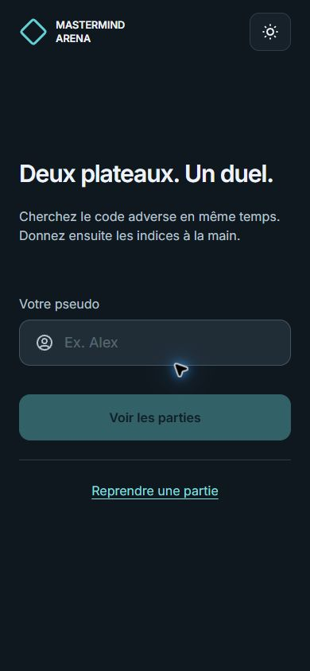
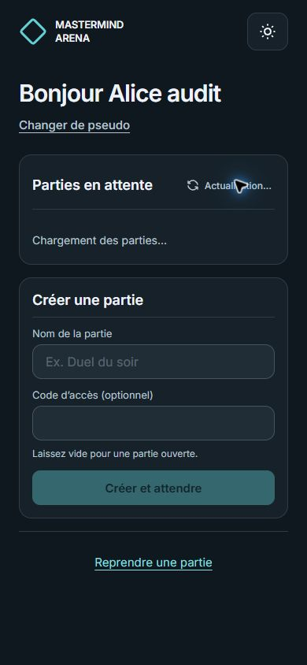

### 2 — Refus, nouvel envoi et attente

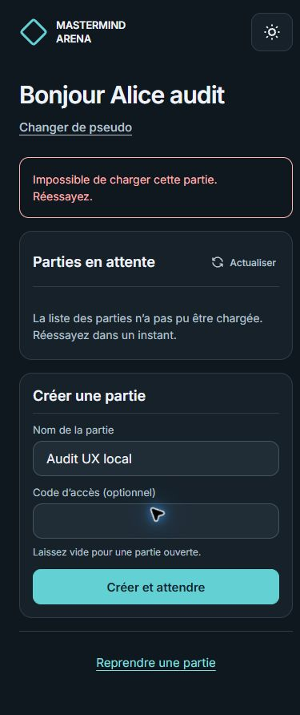
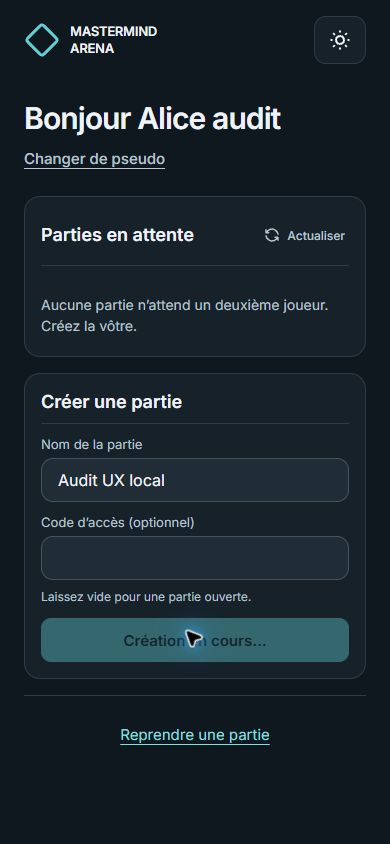
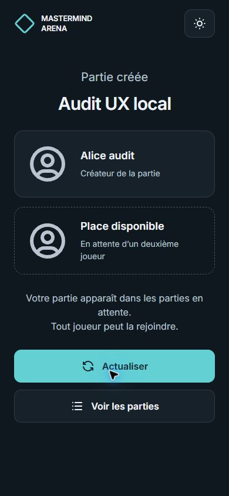

### 3 — Secret et premier essai

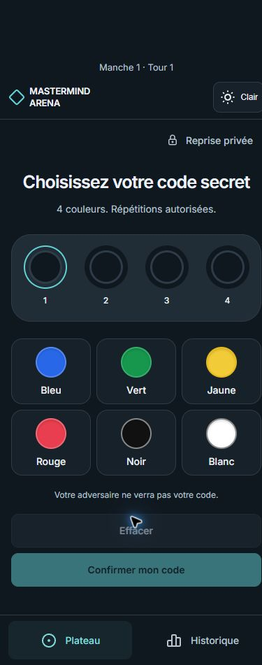
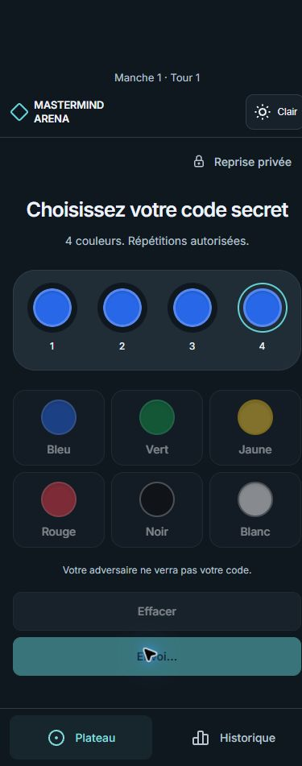
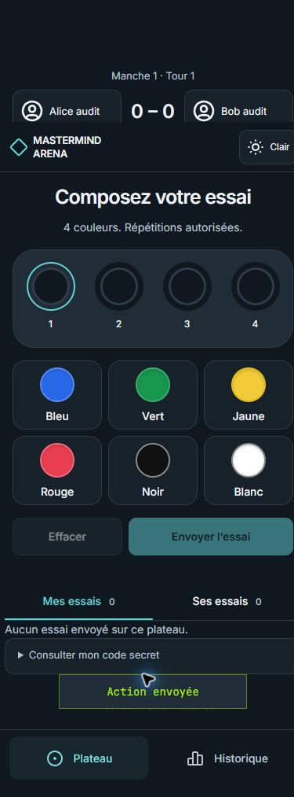
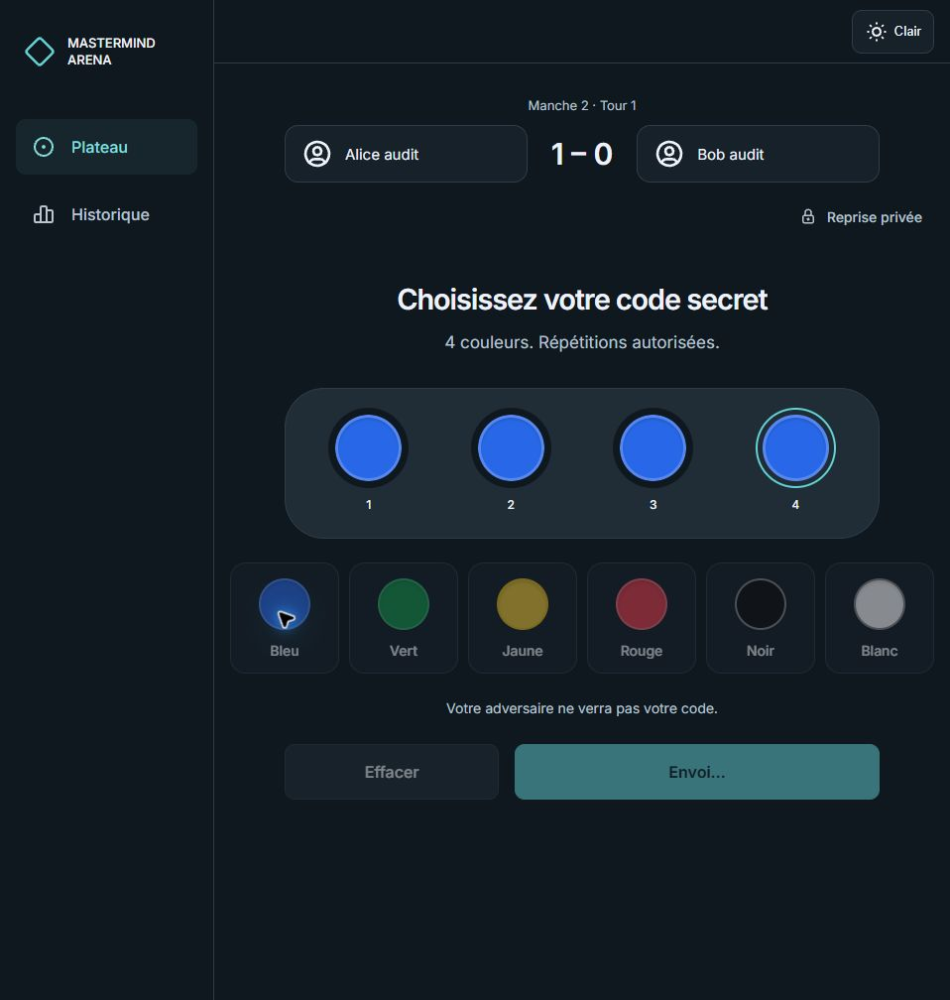

### 4 — Essai et indices

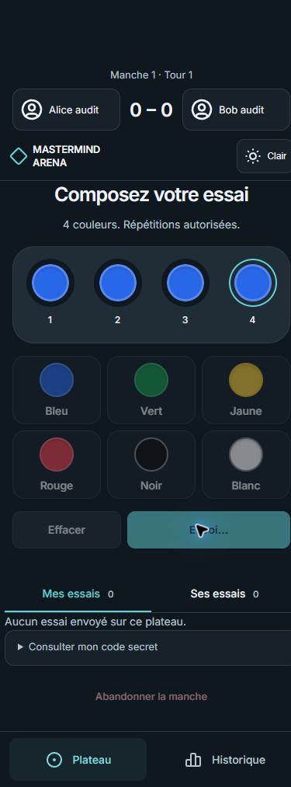
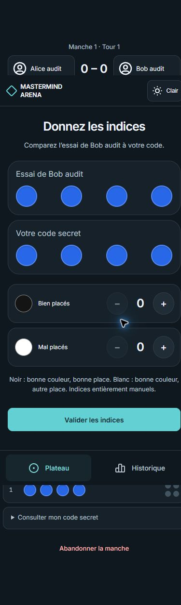
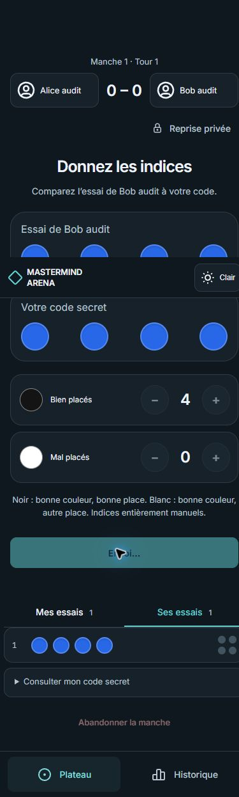

### 5 — Résultat et correction

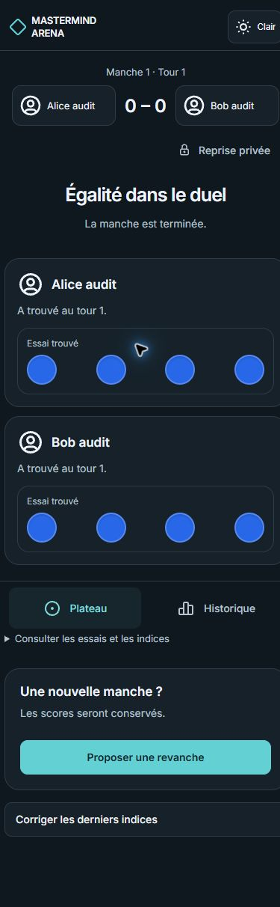
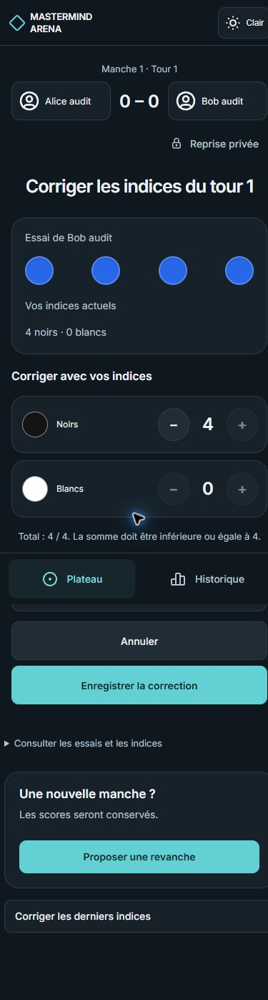
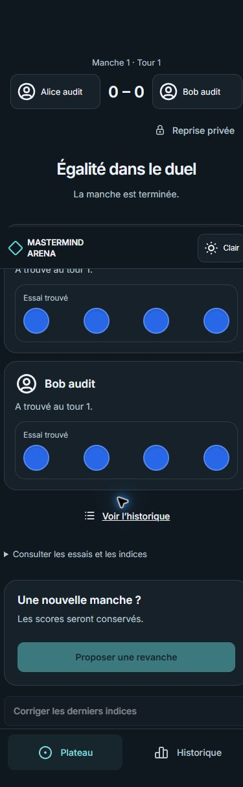
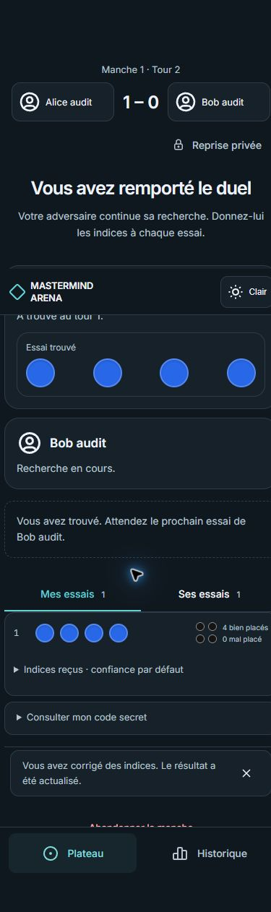

### 6 — Reprise privée et thème clair

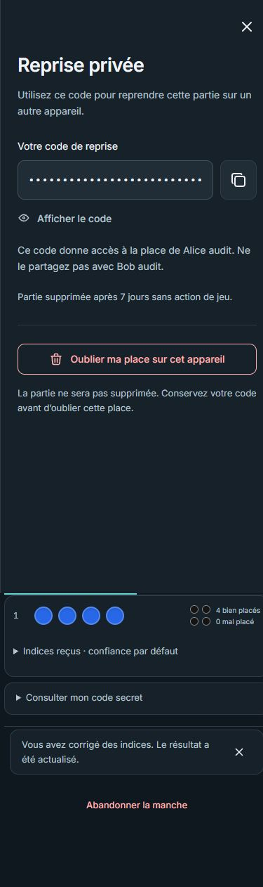
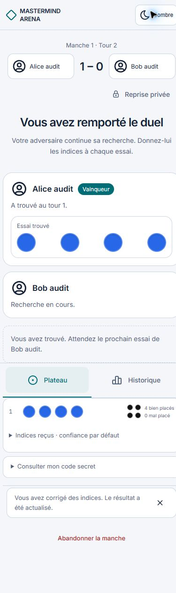

### 7 — Revanche et nouvelle manche

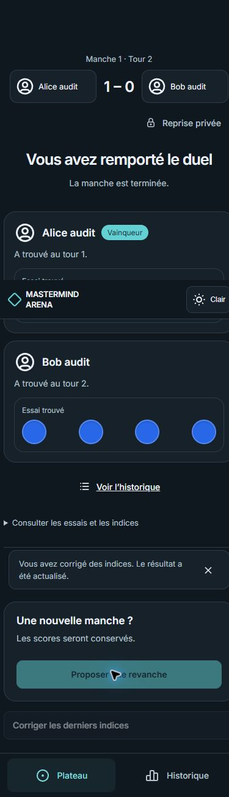
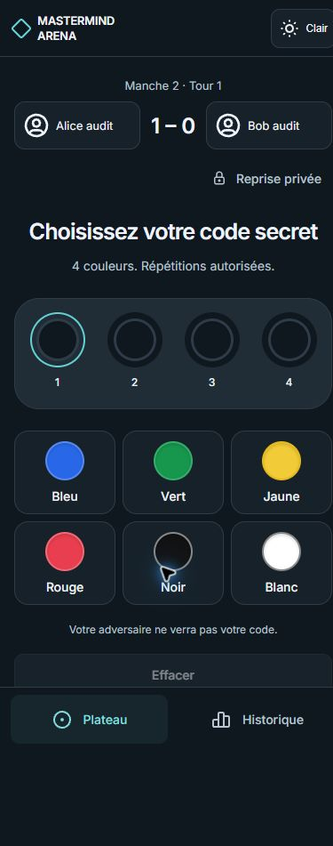

### 8 — Tailles complémentaires

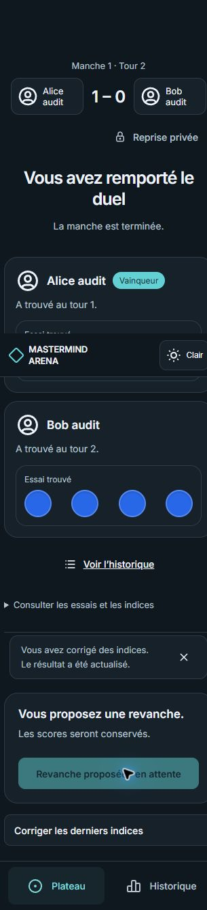
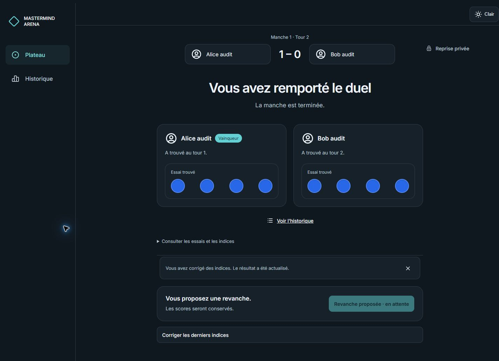

## Suite proposée

Corriger UX-01 à UX-04 dans un lot borné après validation des textes, destinations de focus et comportement de correction. Rejouer ensuite les refus/lenteurs, puis compléter zoom réel et noms longs. A2 et A4 restent partiels ; A1 nécessite toujours la revue du concepteur, A3 ses décisions et A5 le réseau physique.
