# Corrections de l'audit UX — 27 octobre 2026

UX-01 à UX-04 sont corrigés et contre-vérifiés localement. Les décisions du concepteur portent sur les erreurs contextualisées, le focus conditionnel, les annonces d'envoi, le brouillon de correction et les notifications. Aucun changement de règle, de route HTTP ou de stockage serveur ; aucune publication.

## Changement et preuve

| Défaut de l'audit | Comportement livré | Preuve locale |
|---|---|---|
| UX-01 — Erreurs confondues | Erreurs de liste, statut d'attente, admission et reprise séparées. Création/jointure/reprise incertaines contextualisées ; refus connus conservés | POST 500 de création sans erreur de liste, POST 500 de jointure puis vrai code incorrect, POST 500 de reprise ; focus sur le bouton au refus |
| UX-02 — Focus perdu | Bouton d'envoi conservé au clavier avec aria-disabled et garde d'action. Après confirmation, titre de phase ciblé seulement si le focus n'a pas été déplacé. Polling sans transfert clavier | Création vers titre d'attente ; indices/correction vers résultat ; demande de revanche vers confirmation ; reprise valide vers phase. Changement volontaire de thème pendant l'essai respecté après réponse |
| UX-03 — Attente peu explicite | Région de statut pour chaque soumission ; texte de revanche distinguant envoi et attente adverse | Code/essai/indices/correction/revanche lus pendant les délais. Second appui Entrée pendant l'essai sans deuxième action acceptée (version 3 vers 4) |
| UX-04 — Correction fermée trop tôt | Éditeur et compteurs maintenus pendant la requête et au refus ; fermeture après confirmation, si la cible est encore celle éditée | 500 simulé : 3 noirs / 0 blanc conservés, focus sur Enregistrer. Retry lent : éditeur ouvert, puis résultat corrigé ; correction suivante confirmée vers égalité et titre focalisé |

La dernière notification d'erreur reste visible jusqu'à fermeture et ne peut pas être remplacée par un succès. Le bandeau est dans le flux avant le contenu, conformément au complément validé, pour ne pas masquer l'action sur mobile. La fermeture rend le focus au déclencheur encore présent. Les confirmations de succès conservent leur délai de 2,4 secondes ; les notifications de correction/vérification propres au plateau restent inchangées. Il n'y a pas de nouvelle file d'erreurs.

## Vérifications exécutées

- 82 tests front, aucun ignoré, dont erreurs par opération, invariance des requêtes partagées, réponses tardives, annonces par action et six tests de suivi de focus (contexte, déplacement aller-retour, annulation, nouvel envoi, rendu différé et clic ailleurs).
- Lint, Svelte Check sans erreur/avertissement et build. Les sorties sont consignées dans VALIDATION ; aucune suite backend complète rejouée pour ces changements front.
- Chrome avec API Java et PostgreSQL 16 jetable, sans Supabase. Réponses retardées de six ou huit secondes ; refus techniques injectés avant transmission au backend. Combinaisons et identités synthétiques ; captures de codes de reprise masqués uniquement.
- Mobile 390 pixels, clair/sombre et création en largeur native desktop. Erreur encore présente longtemps après 2,4 secondes, puis fermeture manuelle ; focus gardé au refus. Résultat, demande de revanche et reprise valide avec titre actif constatés.
- Reprise valide de la place synthétique p2 après une reprise refusée, sans perte de la partie sauvegardée. Manche 2 retrouvée après consentement de l'adversaire de test.

Des captures de la première itération ont été rejetées : notification flottante avant le placement approuvé, cadrage mobile réduit et capture d'indices antérieure à l'état attendu. Des délais de capture Chrome ont conduit à reprendre les vues stabilisées. Ces images ne servent pas de preuves finales.

## Captures acceptées

1. Création refusée : message propre à l'opération, liste distincte et focus conservé.

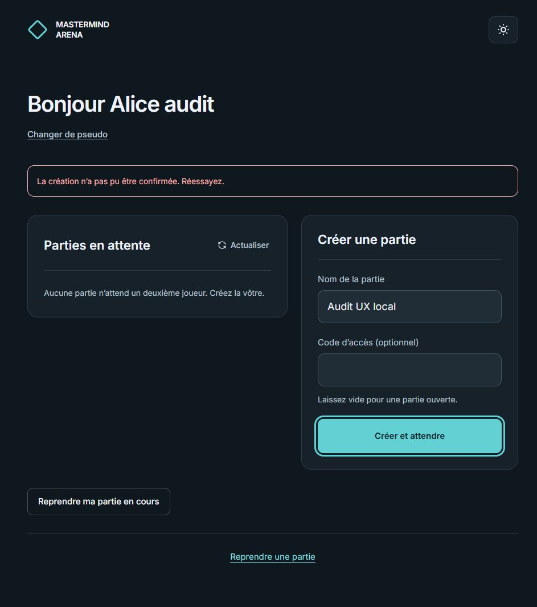

2. Création confirmée : titre d'attente focalisé.

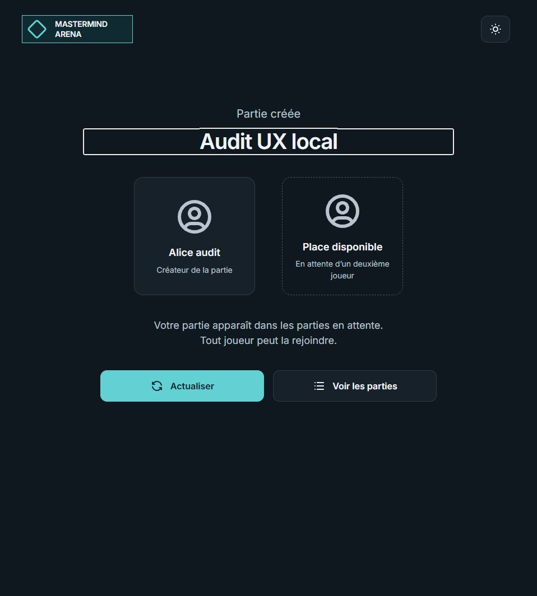

3. Indices confirmés : titre du résultat actif, sans perte de repère.

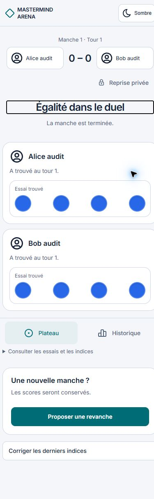

4. Correction refusée : bandeau dans le flux, éditeur et brouillon conservés.

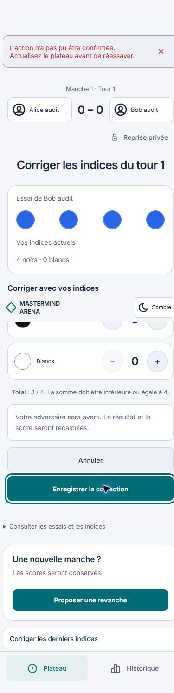

5. Retry de correction : éditeur ouvert pendant l'enregistrement.

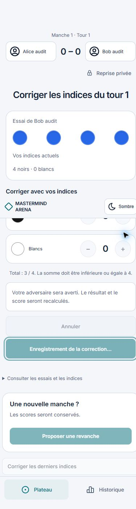

6. Correction confirmée : éditeur fermé et titre du résultat focalisé.

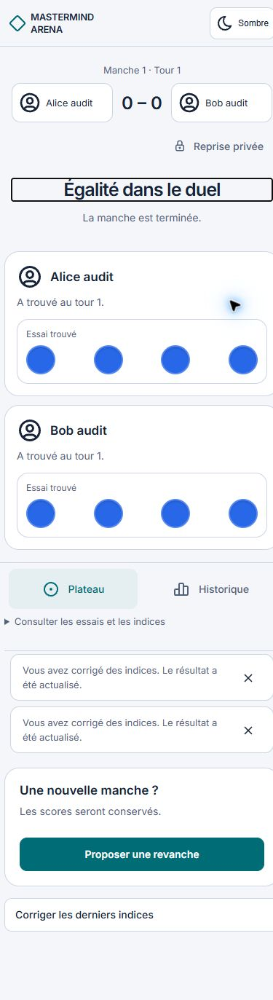

7. Demande de revanche en cours d'envoi.

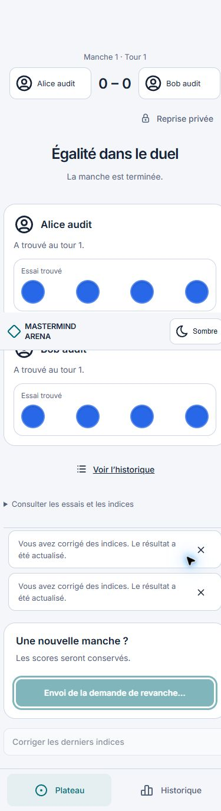

8. Demande reçue par le serveur : attente de l'adversaire et titre de confirmation actif.

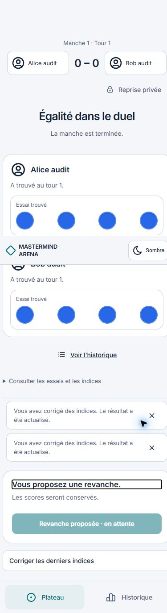

9. Jointure : refus métier conservé et bouton Entrer focalisé.

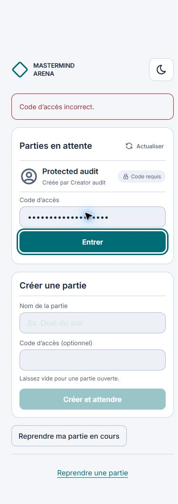

10. Reprise refusée : message contextualisé et focus sur le bouton de reprise.

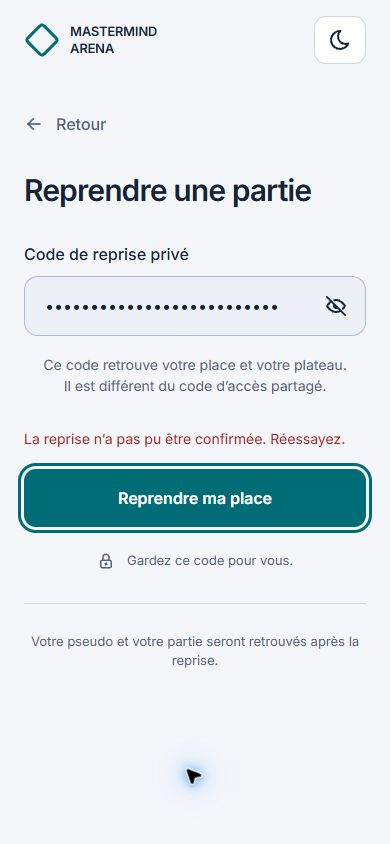

11. Reprise confirmée : titre de la phase focalisé, aucune erreur résiduelle.

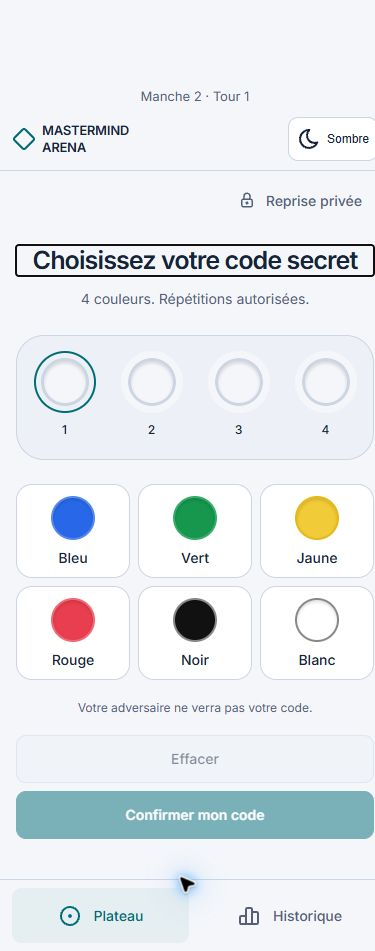

## Limites et suite

Complément du même jour : jointure protégée réussie depuis l'interface, avec réponse retardée de huit secondes et focus conservé puis placé sur le titre de préparation. [Pendant l'envoi](screenshots/ux-join-20261027/01-jointure-lente.png), [après confirmation](screenshots/ux-join-20261027/02-jointure-confirmee.png). Cette preuve termine les parcours ciblés A2 avec les contrôles ci-dessus ; ce n'est pas une matrice exhaustive des refus et navigations possibles.

Les quatre défauts nommés et A2 sont clôturés localement ; A4 garde le zoom réel, les noms maximaux et l'essai audio de lecteur d'écran. La correction conserve son brouillon dans l'éditeur actif tant que la cible reste modifiable ; une nouvelle manche ou un nouveau tour rendant la cible invalide ne le réapplique pas.

Les contre-vérifications visuelles et de parcours utilisent Vite servant la source actuelle ; le build final a été compilé séparément. Ce n'est pas une preuve de CI distante ni du rendu publié. Complément ultérieur du 27 octobre : le message de partie indisponible A3 a été approuvé, intégré et vérifié ; détail dans ERROR_MESSAGES et VALIDATION. Les parties de test et le proxy restent isolés de la production.
